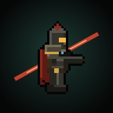

# Hullbreach

A grimdark co-op pixel-art extraction game. Fly your ship between sectors, take contracts from brokers and pilgrims, board burning derelicts, and get the black box out before the husks, the fire or the vacuum get you.

Turn-based, simulation-driven, and built for squads of up to four.



## Play

- **On your phone:** open the GitHub Pages site (see *Deploying* below), then use your browser's **Add to Home Screen** / **Install app**. It runs full-screen and works offline for solo play.
- **On PC:** open the same site in any modern browser.
- **Squads:** co-op currently runs in the claude.ai Artifact build of the game (it uses claude.ai's real-time rooms and per-player cloud saves). A standalone multiplayer server for the app is next on the roadmap.

## What's in the game

- **Simulation first.** Zone atmosphere with decompression and wind, spreading fire that needs oxygen, chain-reacting fuel drums, station power, doors that husks batter down.
- **Per-limb wounds.** Bleeding, crippled legs, ruined aim, suit oxygen, trauma kits.
- **Your ship.** Walk the bridge, armory, hold and airlock. Six terminals: helm (star map), loadout rack, stash locker, contract board, records, airlock.
- **A small galaxy.** Three sectors, nine locations: stations with traders, outposts with contract givers, and four derelicts with their own hazards (KS-9's cargo fire, Tithe Hulk 7's dead power, the Mercy of Iron's extra husks, Pyre Station's inferno).
- **Extraction economy.** Starter kit (free, nothing at risk) or a custom kit from your stash (lost if you die). Gear with real stats: three weapons, three suits, two packs.
- **Squad tactics.** Shared vision, name tags, crew cards, pings, chat, downed-and-revive, handing items over, friendly fire.

## Controls

| | PC | Phone |
|---|---|---|
| Move | WASD / arrows, or click a tile to walk | D-pad, or tap a tile |
| Shoot | Click a husk, window or fuel drum | Tap once to target, tap again or **FIRE** |
| Use / interact | F | **USE** |
| Pick up | G | **GRAB** |
| Items | 1–9, or click the hotbar | Hotbar or **Kit** drawer |
| Ping (squads) | Z, middle-click or Alt+click | Long-press |
| Chat (squads) | Enter | **Chat** |
| Give item (squads) | Right-click it on the hotbar | Kit → *Hand to…* |

## Project layout

```
src/
  head.html   markup + styles (HUD, panels, touch controls)
  sim.js      the rules: pure, deterministic, serialisable state (Sim.act / Sim.newGame)
  world.js    galaxy, traders, contracts, the crew ship (World.act)
  client.js   pixel-art renderer, lighting, effects, input
  base.js     ship base: terminals, loadout, stash, travel, raids, saves
  net.js      squads over claude.ai rooms: host-sequenced lockstep + replay
  squadui.js  shared vision, tags, pings, chat, crew cards, revive/give
  boot.js     start-up
web/          app manifest, service worker, icons
tools/        build.mjs (no dependencies), make-icons.mjs (Playwright)
tests/        rules tests (plain Node)
```

### How multiplayer stays in sync

`Sim` is deterministic: every random roll comes from a seed stored in the state. In a squad the leader's page is the sequencer: crew send action requests, the leader applies them with `Sim.act` and broadcasts `{n, actor, action}`; every page replays the same numbered actions on the same seeded station. Messages stay tiny (well under the 4 KB room limit), a missed message triggers a replay of the action log, and a state hash every few actions catches divergence. Ship walking is cosmetic and travels as presence instead.

The same protocol is what the future app server will relay.

## Development

Requires Node 18+.

```sh
npm test          # rules tests
npm run build     # dist/app (web app) and dist/artifact.html (claude.ai build)
npm run serve     # build and serve dist/app locally
npm run icons     # regenerate app icons from the game sprite (needs Playwright)
```

## Deploying

### GitHub Pages (installable web app)

The workflow in `.github/workflows/pages.yml` runs the tests and deploys `dist/app` on every push to `main`.

One-time setup: **Settings → Pages → Build and deployment → Source: GitHub Actions**. The site appears at `https://<owner>.github.io/<repo>/`.

### Android and iOS apps (Capacitor)

The web app is wrapped as a native app with [Capacitor](https://capacitorjs.com/). On your own machine:

```sh
npm install
npx cap add android      # needs Android Studio
npx cap add ios          # needs a Mac with Xcode
npm run cap:android      # build, sync, open in Android Studio
npm run cap:ios          # build, sync, open in Xcode
```

Publishing needs a Google Play developer account (one-time fee) and/or an Apple Developer Program membership (yearly).

## Roadmap

- Multiplayer server for the app (WebSocket relay for the existing lockstep protocol, plus account saves)
- Second enemy type that hunts by sound
- Two-person actions: forcing the vault together, carrying downed crew
- More contracts and derelict layouts
